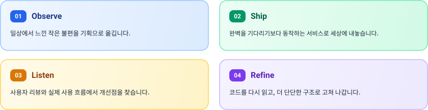

<!-- Header Cover -->

 

### 안녕하세요, 일상의 작은 불편을 서비스로 만드는 Silnoon입니다.

*문학을 읽던 시선으로 사람을 관찰하고, 코드를 써서 실제 쓰이는 앱으로 옮깁니다.*  
*만드는 데서 멈추지 않고, 사용자의 목소리를 다시 코드로 연결하며 성장하고 있습니다.*

 

<!-- Links -->

 

### 🌿 About Me

- **Product Builder & Android Developer** — 2026년 개발을 시작해 사업자 등록 후, Google Play에서 **25개 이상의 Android 앱**을 직접 기획·개발·운영해 왔습니다.
- **User-Driven Iteration** — 앱을 출시한 뒤 직접 써 보고, 사용자 리뷰를 읽으며 불편한 지점을 코드 수정으로 연결하는 과정을 가장 중요하게 생각합니다.
- **Deepening Fundamentals** — 빠르게 만들어 본 경험 위에 **Kotlin, 자료구조·알고리즘, 앱 구조**를 차근차근 쌓으며, 기존에 만든 코드를 다시 꺼내 점검하고 리팩토링하고 있습니다.
- **Writing & Sharing** — 기획부터 출시, 운영, 코드 개선까지의 고민과 기록을 **GitHub · LinkedIn · YouTube(`시도노트`)** 에 꾸준히 남깁니다.

 

### ✨ Featured Works

> 실제 출시·운영 경험과 리팩토링·설계 기록을 중심으로 정리한 대표 저장소입니다.

| 프로젝트 | 소개 | 기록 & 특징 |
| :--- | :--- | :--- |
| 📈 **[주식매매노트](https://github.com/SilnoonE/trade-journal_260916)** | 매수·매도·배당 기록, 수익 시각화, PDF 리포트 제공 투자 기록 앱 | 누적 기기 1,400+ · 평점 4.4 · 리뷰 기반 당일/익일 개선 및 리팩토링 기록 |
| 🧾 **[내세금관리](https://github.com/SilnoonE/my-tax-manager_261028)** | 개인사업자·프리랜서를 위한 매출·비용·영수증 관리 Android 앱 | 첫 수익 이후 개편 과정, 실제 화면 및 Kotlin UI 기술 기록 |
| 🚗 **[차곡](https://github.com/SilnoonE/car-log_261015)** | 주유부터 정비까지 자동차 유지비를 한곳에 기록하는 Android 앱 | 서비스 소개 및 Kotlin UI 공개 데모 |
| 🩸 **[혈당지킴이](https://github.com/SilnoonE/glucose-guard_261007)** | 가족을 위해 직접 만든 당뇨·혈당 기록 관리 앱 | Kotlin/XML · Room · PDF · 알림 · 백업 리뉴얼 전후 공개 코드 |
| 📍 **[그때그곳](https://github.com/SilnoonE/then-and-there_261027)** | 동행과 다녀온 장소를 사진과 함께 남기는 Android 앱 | 초기 구조, 개발 기록 및 선별 Kotlin 예제 |
| ⏰ **[제시간에](https://github.com/SilnoonE/jesigane_261107)** | 친구 약속·모의 예약금·만장일치 투표 서비스 *(TypeScript)* | 웹으로 확장한 기획·설계 및 개발 기록 |
| 📖 **[갈피](https://github.com/SilnoonE/bookmark-reader_261011)** | Windows 환경에서 가볍게 쓰는 만화·소설 뷰어 | 실행 파일 배포 및 업데이트 안내 |
| 🛠️ **[App Review Helper](https://github.com/SilnoonE/app-review-helper_260915)** | 앱 사용자 리뷰를 분류하고 개선 작업을 정리하는 웹 도구 | 25+ 앱 운영 과정에서 직접 만든 운영 보조 툴 |

<b>📂 지금까지 출시·개발한 25+ 앱 아카이브 펼쳐보기</b>

 

- **금융 · 생활관리**: 주식매매노트, 내세금관리, 간단가계부(BudgetNote), 오일트렌드, 등기체크, 차라리, 차곡
- **건강 · 기록 · 일상**: 혈당지킴이, 식단루틴, 운동메이트, 무브로그, PageRoom(독서기록), 그때그곳, 라온필름, 커리어노트, 이름공방, 지금 이 순간, 오늘의 지혜, 오늘의 운명, 오늘 누가 쏠래?, 톡큐
- **게임 · 테스트**: 라스트 아처, 지뢰찾기 Go, Number Merge, 탭탭 벌크업, 우리집 강아지, 비틀봇, 연애 성격 테스트
- **웹 · 데스크톱 확장**: 제시간에, 갈피(Windows), App Review Helper

 

### 🧩 How I Work

 

### 🛠️ Tech & Focus

**Main**  

**Web & Tools**  

**Currently Studying**  
`Kotlin Deep Dive` · `Data Structures & Algorithms` · `App Architecture` · `Refactoring`

 

### 📝 Where I Share

- **LinkedIn** — AI 시대의 개발, UX/UI, 인문학적 관점과 매일의 실행 기록 → [LinkedIn 프로필](https://www.linkedin.com/in/hyechan-yoon-a171a83b5/)
- **YouTube (`시도노트`)** — 직접 만든 앱·프로그램 출시 이야기와 취준·개발 회고 → [@시도노트](https://www.youtube.com/@%EC%8B%9C%EB%8F%84%EB%85%B8%ED%8A%B8)

 

